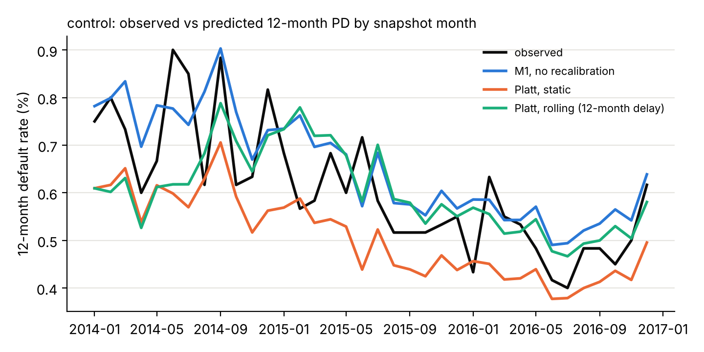
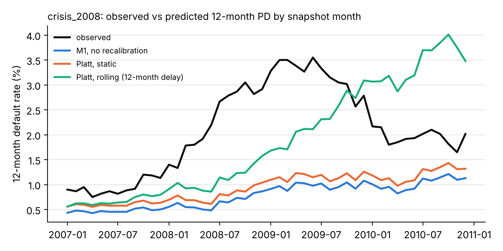
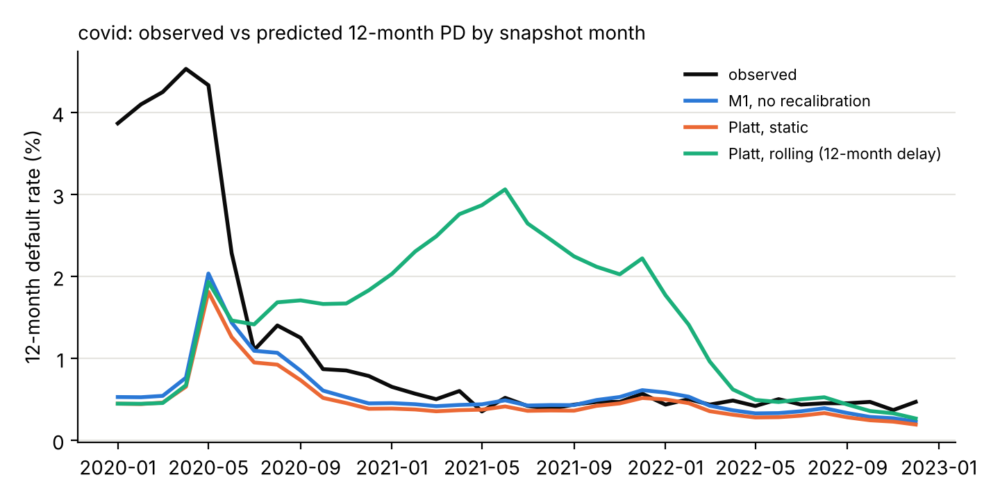

# Results summary

All numbers below come from the Freddie Mac SFLLD standard sample files (1999-2026 vintages) and FRED macro series, produced by `make experiments` / `make select`. 12-month PD at monthly snapshots; test windows are out of time.

## control

Windows: {'train': [None, 201112], 'validate': [201201, 201212], 'gap': [201301, 201312], 'test': [201401, 201612]}. Training: 3997837 landmark pairs from 42712 loans (vintages 1999-2011), 6227 defaults. Test snapshots: 216000 loan-months. Pooled LGD 0.438 from 12486 resolved defaults.

**Models, deployable (persistence) macro path**

| model | val obs/pred | val AUC | test events | test obs rate | test pred rate | pred/obs | test AUC [95% CI] | ECE | cal slope | std monthly CITL |
|---|---|---|---|---|---|---|---|---|---|---|
| B0 | 0.0120 / 0.0152 | 0.887 | 1314 | 0.0061 | 0.0057 | 0.94 | 0.870 [0.850, 0.888] | 0.0008 | 0.92 | 0.0008 |
| B1 | 0.0120 / 0.0168 | 0.867 | 1314 | 0.0061 | 0.0168 | 2.76 | 0.844 [0.821, 0.864] | 0.0107 | 0.70 | 0.0011 |
| M1 | 0.0120 / 0.0152 | 0.885 | 1314 | 0.0061 | 0.0066 | 1.08 | 0.880 [0.862, 0.895] | 0.0010 | 0.93 | 0.0008 |

**Predicted / observed 12-month default rate by macro path**

| model | baseline | downside | oracle | upside |
|---|---|---|---|---|
| B0 | 0.938 | 1.174 | 0.936 | 0.885 |
| B1 | 2.759 | nan | nan | nan |
| M1 | 1.078 | 1.209 | 1.084 | 1.079 |

**Recalibration of M1**

| method | mode | pred/obs | AUC | ECE | cal slope | std monthly CITL | max abs monthly CITL |
|---|---|---|---|---|---|---|---|
| none | static | 1.08 | 0.880 | 0.0010 | 0.93 | 0.0008 | 0.0020 |
| intercept | static | 0.82 | 0.880 | 0.0011 | 0.93 | 0.0008 | 0.0031 |
| intercept | rolling | 0.97 | 0.879 | 0.0007 | 0.93 | 0.0011 | 0.0030 |
| platt | static | 0.83 | 0.880 | 0.0010 | 0.96 | 0.0008 | 0.0030 |
| platt | rolling | 0.99 | 0.879 | 0.0002 | 1.02 | 0.0011 | 0.0028 |
| isotonic | static | 0.85 | 0.878 | 0.0009 | 0.88 | 0.0008 | 0.0028 |
| isotonic | rolling | 1.00 | 0.875 | 0.0004 | 0.95 | 0.0011 | 0.0026 |
| iw_platt | static | 0.79 | 0.879 | 0.0013 | 0.84 | 0.0009 | 0.0031 |
| iw_platt | rolling | 0.84 | 0.879 | 0.0010 | 1.01 | 0.0009 | 0.0030 |

**Recalibration of B1**

| method | mode | pred/obs | AUC | ECE | cal slope | std monthly CITL | max abs monthly CITL |
|---|---|---|---|---|---|---|---|
| none | static | 2.76 | 0.844 | 0.0107 | 0.70 | 0.0011 | 0.0124 |
| intercept | static | 1.89 | 0.844 | 0.0054 | 0.70 | 0.0011 | 0.0071 |
| intercept | rolling | 1.31 | 0.846 | 0.0020 | 0.69 | 0.0011 | 0.0044 |
| platt | static | 1.89 | 0.844 | 0.0054 | 0.72 | 0.0011 | 0.0071 |
| platt | rolling | 1.33 | 0.846 | 0.0020 | 0.88 | 0.0010 | 0.0044 |
| isotonic | static | 1.91 | 0.841 | 0.0056 | 0.84 | 0.0011 | 0.0073 |
| isotonic | rolling | 1.33 | 0.840 | 0.0022 | 0.91 | 0.0010 | 0.0045 |
| iw_platt | static | 1.69 | 0.846 | 0.0042 | 0.88 | 0.0009 | 0.0061 |
| iw_platt | rolling | 1.05 | 0.839 | 0.0027 | 1.12 | 0.0015 | 0.0051 |

**12-month ECL, predicted / realised (same LGD and EAD)**

| model | path | ratio |
|---|---|---|
| B0 | baseline | 1.164 |
| B0 | oracle | 1.161 |
| B1 | baseline | 3.789 |
| M1 | baseline | 1.093 |
| M1 | oracle | 1.099 |
| B0 | weighted | 1.243 |
| B1 | weighted | 3.789 |
| M1 | weighted | 1.127 |

**NSGA-II selection: single-objective picks vs Pareto knee (test scored after selection)**

| pick | mode | method | num_leaves | learning_rate | min_child_samples | feature_fraction | val_auc | val_ece | val_citl_monthly_std | test_auc | test_ece | test_ratio | test_citl_monthly_std |
|---|---|---|---|---|---|---|---|---|---|---|---|---|---|
| min_brier; | static | platt | 20 | 0.0186 | 223 | 0.9292 | 0.8887 | 0.0023 | 0.0026 | 0.8663 | 0.0009 | 0.9131 | 0.0015 |
| min_brier; | rolling | platt | 20 | 0.0186 | 223 | 0.9292 | 0.8887 | 0.0023 | 0.0026 | 0.8624 | 0.001 | 1.1137 | 0.0019 |
| max_auc; | static | iw_platt | 16 | 0.0253 | 186 | 0.7388 | 0.8915 | 0.0037 | 0.0037 | 0.8703 | 0.0052 | 1.8313 | 0.0013 |
| max_auc; | rolling | iw_platt | 16 | 0.0253 | 186 | 0.7388 | 0.8915 | 0.0037 | 0.0037 | 0.8705 | 0.0013 | 1.1585 | 0.0016 |
| min_ece; | static | none | 82 | 0.0182 | 160 | 0.5587 | 0.8789 | 0.0009 | 0.0025 | 0.862 | 0.0007 | 0.9391 | 0.0011 |
| min_ece; | rolling | none | 82 | 0.0182 | 160 | 0.5587 | 0.8789 | 0.0009 | 0.0025 | 0.862 | 0.0007 | 0.9391 | 0.0011 |
| knee; | static | intercept | 16 | 0.0298 | 107 | 0.9685 | 0.8881 | 0.0021 | 0.0025 | 0.8689 | 0.0007 | 0.9125 | 0.0012 |
| knee; | rolling | intercept | 16 | 0.0298 | 107 | 0.9685 | 0.8881 | 0.0021 | 0.0025 | 0.8675 | 0.0007 | 1.0583 | 0.0016 |

Pareto set: 31 of 128 evaluated candidates.

## crisis_2008

Windows: {'train': [None, 200412], 'validate': [200501, 200512], 'gap': [200601, 200612], 'test': [200701, 201012]}. Training: 3998365 landmark pairs from 121590 loans (vintages 1999-2004), 3901 defaults. Test snapshots: 288000 loan-months. Pooled LGD 0.159 from 1142 resolved defaults.

**Models, deployable (persistence) macro path**

| model | val obs/pred | val AUC | test events | test obs rate | test pred rate | pred/obs | test AUC [95% CI] | ECE | cal slope | std monthly CITL |
|---|---|---|---|---|---|---|---|---|---|---|
| B0 | 0.0064 / 0.0065 | 0.923 | 6038 | 0.0210 | 0.0020 | 0.10 | 0.813 [0.803, 0.823] | 0.0190 | 0.82 | 0.0095 |
| B1 | 0.0064 / 0.0054 | 0.920 | 6038 | 0.0210 | 0.0062 | 0.29 | 0.859 [0.851, 0.867] | 0.0148 | 0.99 | 0.0083 |
| M1 | 0.0064 / 0.0052 | 0.924 | 6038 | 0.0210 | 0.0078 | 0.37 | 0.855 [0.847, 0.865] | 0.0132 | 0.82 | 0.0075 |

**Predicted / observed 12-month default rate by macro path**

| model | baseline | downside | oracle | upside |
|---|---|---|---|---|
| B0 | 0.096 | 0.077 | 0.086 | 0.103 |
| B1 | 0.293 | nan | nan | nan |
| M1 | 0.372 | 0.378 | 0.398 | 0.372 |

**Recalibration of M1**

| method | mode | pred/obs | AUC | ECE | cal slope | std monthly CITL | max abs monthly CITL |
|---|---|---|---|---|---|---|---|
| none | static | 0.37 | 0.855 | 0.0132 | 0.82 | 0.0075 | 0.0263 |
| intercept | static | 0.46 | 0.855 | 0.0114 | 0.82 | 0.0073 | 0.0242 |
| intercept | rolling | 0.92 | 0.848 | 0.0068 | 0.75 | 0.0117 | 0.0231 |
| platt | static | 0.45 | 0.855 | 0.0116 | 0.86 | 0.0074 | 0.0245 |
| platt | rolling | 0.89 | 0.837 | 0.0043 | 0.84 | 0.0115 | 0.0219 |
| isotonic | static | 0.45 | 0.853 | 0.0115 | 0.67 | 0.0075 | 0.0241 |
| isotonic | rolling | 0.88 | 0.842 | 0.0043 | 0.79 | 0.0114 | 0.0218 |
| iw_platt | static | 0.41 | 0.851 | 0.0123 | 0.86 | 0.0073 | 0.0257 |
| iw_platt | rolling | 0.98 | 0.842 | 0.0038 | 0.86 | 0.0097 | 0.0176 |

**Recalibration of B1**

| method | mode | pred/obs | AUC | ECE | cal slope | std monthly CITL | max abs monthly CITL |
|---|---|---|---|---|---|---|---|
| none | static | 0.29 | 0.859 | 0.0148 | 0.99 | 0.0083 | 0.0284 |
| intercept | static | 0.35 | 0.859 | 0.0137 | 0.99 | 0.0082 | 0.0273 |
| intercept | rolling | 0.73 | 0.853 | 0.0057 | 0.90 | 0.0103 | 0.0224 |
| platt | static | 0.36 | 0.859 | 0.0135 | 0.86 | 0.0080 | 0.0270 |
| platt | rolling | 0.73 | 0.849 | 0.0056 | 0.85 | 0.0101 | 0.0221 |
| isotonic | static | 0.36 | 0.856 | 0.0134 | 0.68 | 0.0081 | 0.0269 |
| isotonic | rolling | 0.73 | 0.851 | 0.0057 | 0.80 | 0.0101 | 0.0222 |
| iw_platt | static | 0.50 | 0.859 | 0.0104 | 0.84 | 0.0073 | 0.0233 |
| iw_platt | rolling | 0.92 | 0.854 | 0.0030 | 0.88 | 0.0089 | 0.0152 |

**12-month ECL, predicted / realised (same LGD and EAD)**

| model | path | ratio |
|---|---|---|
| B0 | baseline | 0.07 |
| B0 | oracle | 0.063 |
| B1 | baseline | 0.225 |
| M1 | baseline | 0.28 |
| M1 | oracle | 0.302 |
| B0 | weighted | 0.067 |
| B1 | weighted | 0.225 |
| M1 | weighted | 0.281 |

**NSGA-II selection: single-objective picks vs Pareto knee (test scored after selection)**

| pick | mode | method | num_leaves | learning_rate | min_child_samples | feature_fraction | val_auc | val_ece | val_citl_monthly_std | test_auc | test_ece | test_ratio | test_citl_monthly_std |
|---|---|---|---|---|---|---|---|---|---|---|---|---|---|
| knee; | static | isotonic | 75 | 0.0251 | 279 | 0.5439 | 0.9241 | 0.0008 | 0.0012 | 0.8437 | 0.0103 | 0.5101 | 0.0067 |
| knee; | rolling | isotonic | 75 | 0.0251 | 279 | 0.5439 | 0.9241 | 0.0008 | 0.0012 | 0.833 | 0.004 | 0.897 | 0.0098 |
| max_auc; | static | none | 147 | 0.0231 | 70 | 0.509 | 0.9285 | 0.0031 | 0.0013 | 0.8462 | 0.0146 | 0.3035 | 0.0078 |
| max_auc; | rolling | none | 147 | 0.0231 | 70 | 0.509 | 0.9285 | 0.0031 | 0.0013 | 0.8462 | 0.0146 | 0.3035 | 0.0078 |
| min_brier; | static | none | 76 | 0.0252 | 161 | 0.5485 | 0.9246 | 0.0021 | 0.0013 | 0.847 | 0.0129 | 0.3849 | 0.0074 |
| min_brier; | rolling | none | 76 | 0.0252 | 161 | 0.5485 | 0.9246 | 0.0021 | 0.0013 | 0.847 | 0.0129 | 0.3849 | 0.0074 |
| min_ece; | static | isotonic | 143 | 0.0202 | 282 | 0.9093 | 0.9122 | 0.0003 | 0.0013 | 0.8321 | 0.0102 | 0.5132 | 0.0069 |
| min_ece; | rolling | isotonic | 143 | 0.0202 | 282 | 0.9093 | 0.9122 | 0.0003 | 0.0013 | 0.8227 | 0.0047 | 0.9229 | 0.0103 |

Pareto set: 22 of 128 evaluated candidates.

## covid

Windows: {'train': [None, 201712], 'validate': [201801, 201812], 'gap': [201901, 201912], 'test': [202001, 202212]}. Training: 3986238 landmark pairs from 32148 loans (vintages 1999-2017), 5002 defaults. Test snapshots: 216000 loan-months. Pooled LGD 0.454 from 18378 resolved defaults.

**Models, deployable (persistence) macro path**

| model | val obs/pred | val AUC | test events | test obs rate | test pred rate | pred/obs | test AUC [95% CI] | ECE | cal slope | std monthly CITL |
|---|---|---|---|---|---|---|---|---|---|---|
| B0 | 0.0041 / 0.0038 | 0.873 | 2456 | 0.0114 | 0.0046 | 0.41 | 0.834 [0.821, 0.847] | 0.0067 | 0.98 | 0.0111 |
| B1 | 0.0041 / 0.0065 | 0.868 | 2456 | 0.0114 | 0.0063 | 0.55 | 0.815 [0.800, 0.829] | 0.0051 | 1.15 | 0.0123 |
| M1 | 0.0041 / 0.0049 | 0.884 | 2456 | 0.0114 | 0.0057 | 0.50 | 0.822 [0.808, 0.835] | 0.0057 | 0.87 | 0.0116 |

**Predicted / observed 12-month default rate by macro path**

| model | baseline | downside | oracle | upside |
|---|---|---|---|---|
| B0 | 0.408 | 0.497 | 0.336 | 0.39 |
| B1 | 0.555 | nan | nan | nan |
| M1 | 0.498 | 0.486 | 0.458 | 0.51 |

**Recalibration of M1**

| method | mode | pred/obs | AUC | ECE | cal slope | std monthly CITL | max abs monthly CITL |
|---|---|---|---|---|---|---|---|
| none | static | 0.50 | 0.822 | 0.0057 | 0.87 | 0.0116 | 0.0377 |
| intercept | static | 0.43 | 0.822 | 0.0065 | 0.87 | 0.0117 | 0.0388 |
| intercept | rolling | 1.24 | 0.715 | 0.0071 | 0.66 | 0.0171 | 0.0387 |
| platt | static | 0.43 | 0.822 | 0.0065 | 0.87 | 0.0117 | 0.0388 |
| platt | rolling | 1.29 | 0.678 | 0.0083 | 0.71 | 0.0177 | 0.0386 |
| isotonic | static | 0.43 | 0.818 | 0.0065 | 0.80 | 0.0118 | 0.0387 |
| isotonic | rolling | 1.29 | 0.681 | 0.0082 | 0.66 | 0.0177 | 0.0383 |
| iw_platt | static | 0.42 | 0.812 | 0.0065 | 0.97 | 0.0120 | 0.0390 |
| iw_platt | rolling | 1.32 | 0.672 | 0.0092 | 0.72 | 0.0181 | 0.0386 |

**Recalibration of B1**

| method | mode | pred/obs | AUC | ECE | cal slope | std monthly CITL | max abs monthly CITL |
|---|---|---|---|---|---|---|---|
| none | static | 0.55 | 0.815 | 0.0051 | 1.15 | 0.0123 | 0.0368 |
| intercept | static | 0.35 | 0.815 | 0.0074 | 1.15 | 0.0125 | 0.0399 |
| intercept | rolling | 1.28 | 0.681 | 0.0073 | 0.63 | 0.0191 | 0.0402 |
| platt | static | 0.36 | 0.815 | 0.0073 | 0.86 | 0.0122 | 0.0388 |
| platt | rolling | 1.28 | 0.671 | 0.0082 | 0.59 | 0.0189 | 0.0392 |
| isotonic | static | 0.36 | 0.811 | 0.0073 | 0.82 | 0.0122 | 0.0386 |
| isotonic | rolling | 1.28 | 0.659 | 0.0090 | 0.55 | 0.0189 | 0.0390 |
| iw_platt | static | 0.40 | 0.799 | 0.0068 | 1.04 | 0.0124 | 0.0385 |
| iw_platt | rolling | 1.55 | 0.650 | 0.0105 | 0.69 | 0.0193 | 0.0384 |

**12-month ECL, predicted / realised (same LGD and EAD)**

| model | path | ratio |
|---|---|---|
| B0 | baseline | 0.405 |
| B0 | oracle | 0.341 |
| B1 | baseline | 0.573 |
| M1 | baseline | 0.415 |
| M1 | oracle | 0.384 |
| B0 | weighted | 0.429 |
| B1 | weighted | 0.573 |
| M1 | weighted | 0.413 |

**NSGA-II selection: single-objective picks vs Pareto knee (test scored after selection)**

| pick | mode | method | num_leaves | learning_rate | min_child_samples | feature_fraction | val_auc | val_ece | val_citl_monthly_std | test_auc | test_ece | test_ratio | test_citl_monthly_std |
|---|---|---|---|---|---|---|---|---|---|---|---|---|---|
| knee; | static | none | 26 | 0.012 | 389 | 0.9451 | 0.8985 | 0.0008 | 0.001 | 0.8621 | 0.0096 | 0.1461 | 0.0114 |
| knee; | rolling | none | 26 | 0.012 | 389 | 0.9451 | 0.8985 | 0.0008 | 0.001 | 0.8621 | 0.0096 | 0.1461 | 0.0114 |
| max_auc; | static | intercept | 29 | 0.0104 | 1532 | 0.6113 | 0.9101 | 0.0029 | 0.0011 | 0.8404 | 0.0079 | 0.2895 | 0.0115 |
| max_auc; | rolling | intercept | 29 | 0.0104 | 1532 | 0.6113 | 0.9101 | 0.0029 | 0.0011 | 0.6925 | 0.0046 | 1.0448 | 0.0163 |
| min_ece; | static | none | 120 | 0.0274 | 1188 | 0.5896 | 0.8908 | 0.0004 | 0.001 | 0.843 | 0.0091 | 0.1851 | 0.0116 |
| min_ece; | rolling | none | 120 | 0.0274 | 1188 | 0.5896 | 0.8908 | 0.0004 | 0.001 | 0.843 | 0.0091 | 0.1851 | 0.0116 |
| min_brier; | static | none | 121 | 0.0438 | 1084 | 0.6008 | 0.8943 | 0.0008 | 0.0011 | 0.8273 | 0.0083 | 0.2598 | 0.0115 |
| min_brier; | rolling | none | 121 | 0.0438 | 1084 | 0.6008 | 0.8943 | 0.0008 | 0.0011 | 0.8273 | 0.0083 | 0.2598 | 0.0115 |

Pareto set: 24 of 128 evaluated candidates.

